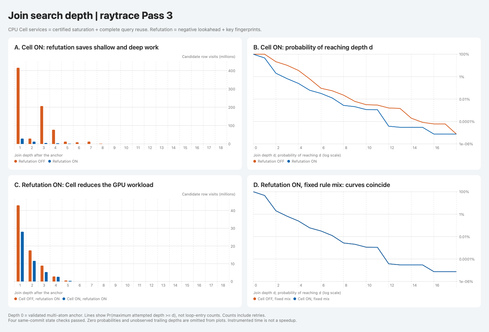

# Join depth distribution: outer starts versus inner work

The measurement separates two effects. **Cell services remove outer GPU
starts; refutation keeps those starts but cuts off their descendant search.**
Most refutations happen immediately after the anchor, so they save the first
Join layer as well as deeper layers. This is not only an innermost-loop saving.



## Scope and definitions

Actual raytrace Pass 3 snapshot, all 547 original rules, same Rust binary,
Swift worker, schedule and native effects. S enables existing CPU saturation
and complete-query reuse; R enables empty-bucket and key-fingerprint refutation.
The four final runs are `out/join-depth-final-s{0,1}r{0,1}`. Each passes the
saved same-commit CPU full-graph check. The fused-native discrepancy remains.
Atomic instrumentation is enabled; **these are work counts, not speedups**.

The first instrumentation pass measured layer work. A second added one
maximum-depth observation per seed to obtain a genuine probability distribution.
Only that final schema/binary quartet is used here; the earlier runs are retained
as development evidence, not repeated timing samples or an average.

The instrumented path is the compact GPU Join executor, not native CPU Free
Join. Unary/unit queries have no nested Join and are outside the seed population.

```text
for eligible anchor binding:                 depth 0
    if lookahead refutes it: continue
    for row from first subsequent atom:      depth 1
        check binding and available guards
        if lookahead refutes prefix: continue
        for row from next atom:              depth 2
            ...
```

Depth is a search-plan position after the chosen delta anchor. It is not
expression-tree depth, source LHS order, or ruleset round. Different anchors
can have different atom orders. Raw layers also mix rules of different lengths.

At each depth we count loop entries, linked/live row visits, successfully bound
prefixes, necessary-key checks, refutations, matching leaves, domain checks,
and signature rejections. Each eligible seed evaluation additionally contributes
once to a histogram of its **deepest attempted Join layer**, across all branches.
Counts include output-capacity retries, and are not unique facts or mutations.

`entries[d] / seeds` is an average number of loop invocations, not a probability:
branching can make it greater than one. The probability of reaching depth d is
computed from the maximum-depth histogram, `Pr(max_depth >= d)`.

## 1. Refutation with Cell services held ON

Both configurations have exactly **13,278,476 eligible outer starts**, including
equal per-rule seed counts. Their inner work differs sharply:

| Join depth | Live rows, R off | Live rows, R on | Share of all saved row visits |
|---|---:|---:|---:|
| 1 | 415,174,078 | 28,077,732 | **54.20%** |
| 2 | 28,693,300 | 11,518,964 | 2.40% |
| 3 | 206,446,496 | 5,328,024 | **28.16%** |
| 4 | 77,915,192 | 2,665,609 | 10.54% |
| 5 | 12,941,138 | 414,171 | 1.75% |
| 6–18 | 21,039,820 | 28,534 | 2.94% |
| Total | 762,210,024 | 48,033,034 | 100% |

**91.55% of refutation events occur at depth 0**: 7,144,255 out of 7,803,841.
Those branches never enter even the first Join layer. The other events happen
on deeper prefixes. A seed can have several deeper refuted branches, so the
refutation-event histogram is not a first-failure histogram over seeds.

| Probability a seed attempts at least this layer | R off | R on |
|---|---:|---:|
| 1 | 100% | **46.20%** |
| 2 | 21.47% | **2.006%** |
| 3 | 10.19% | **0.655%** |
| 4 | 3.555% | **0.247%** |
| 5 | 0.619% | **0.0604%** |

Mean maximum attempted depth falls from **1.3602 to 0.4922**. The deepest
observed layer remains 18; the method has not eliminated worst-case depth.
It has greatly reduced how often search reaches deeper layers and how much
branching work occurs there.

## 2. Cell services with refutation held ON

Cell services reduce outer starts from **40,587,639 to 13,278,476 (−67.28%)**.
They therefore cannot be described as saving only inner loops.

| Join depth | Live rows, S off | Live rows, S on |
|---|---:|---:|
| 1 | 42,965,051 | 28,077,732 |
| 2 | 17,564,681 | 11,518,964 |
| 3 | 9,019,232 | 5,328,024 |
| 4 | 2,745,342 | 2,665,609 |
| 5 | 421,154 | 414,171 |

Most of the removed work lies in the first three layers. The probability of
entering layer 1 drops from 82.02% to 46.20%, but rule mix is a major confound.
Among the 376 common active rules, using S-off seed counts as fixed weights:

| Reach probability, fixed rule mix | S off | S on |
|---|---:|---:|
| Layer 1 | 46.5753% | 46.5475% |
| Layer 2 | 2.00050% | 2.00080% |
| Layer 3 | 0.64798% | 0.65075% |
| Layer 4 | 0.24430% | 0.24531% |

The curves nearly coincide (panel D). This controls rule mix, not individual
bindings, anchors, or index history. It supports the earlier conclusion:
the present Cell service mostly selects a different residual workload; it
does not supply extra Cell-specific constraints to the refuter.

Also, average row visits per remaining seed **increase** from 1.792 to 3.617
when Cell services are enabled with R already on. Total work decreases because
there are far fewer seeds. A higher early-rejection rate alone does not mean
every remaining query is cheaper.

## Counter validation and the legacy retry distinction

For each rule and nonterminal layer the worker and report tool enforce:

```text
entries[d+1] = bound_prefixes[d] - refuted_prefixes[d]
refuted_prefixes[d] <= bound_prefixes[d]
sum(deepest_seed_bins) = eligible_seeds
deepest_seed_bins[0] = immediately_refuted_seeds
```

The first equality is checked per rule: aggregating rules of different lengths
would mix completed queries into continuing prefixes. Row visits, key checks,
refutations and signature rejections are also reconciled with their independent
global counters. The profiler detects per-bin overflow rather than silently
wrapping. The CSV and JSON retain all compiled depths; plots omit only trailing
depths with no observed work. Log axes omit zero probabilities.

A legacy GPU receipt detail surfaced during reconciliation: `join_probes`
is cleared on every output retry and records the last attempt of each packet.
The new depth counters and existing live-row counters retain all work attempts.
They must not be forced to equal that legacy counter:

| Configuration | Compact loop entries, all attempts | Legacy final-attempt probes |
|---|---:|---:|
| S0 R0 | 231,386,643 | 229,531,003 |
| S0 R1 | 61,465,950 | 60,237,385 |
| S1 R0 | 195,679,807 | 194,029,242 |
| S1 R1 | 27,717,499 | 26,650,658 |

Prior live-row/refutation results are unchanged. This is not a correction to
the separate native CPU `probe` counters. Depth data describes the compact
executor; the older general executor does not have these per-depth counters.

## Files and reproduction

- `results.json`: verified four-way inputs, per-depth counts, probabilities,
  raw savings and fixed-rule-mix comparisons.
- `depth.csv`: all numerical bins, including zero-work trailing depths.
- `distribution.png`: Apple Charts plot; no inference is performed while drawing.
- `plot.swift`: offline plot source using macOS SwiftUI/Charts.

Read saved profiles without rerunning:

```sh
/opt/homebrew/bin/python3 skills/cell-assisted-egglog-bench/scripts/bench.py depth \
  --s0r0 out/join-depth-final-s0r0 --s0r1 out/join-depth-final-s0r1 \
  --s1r0 out/join-depth-final-s1r0 --s1r1 out/join-depth-final-s1r1
```

Optional `--output NEW.json` and `--csv NEW.csv` write new artifacts, never
overwrite an existing output. Generate a figure from a saved report:

```sh
xcrun swiftc -parse-as-library -O experiments/join_depth_distribution/plot.swift -o out/join-depth-plot
out/join-depth-plot experiments/join_depth_distribution/results.json out/join-depth-distribution.png
```

New collection uses the existing `bench.py run --all-rules` flow with
`CELL_SEARCH_COUNTERS=1`, toggling `--joint-sat` and `CELL_REFUTATION`. Layout 14
carries a named depth schema. Normal execution allocates no per-depth diagnostic
array and performs none of its atomics. Initial profiles without deepest-seed
bins are rejected by this reporter instead of fabricating probabilities.

All four final full-state checks pass. Ten full-GPU native-oracle regressions
pass with profiling and both filters enabled. Twenty-nine workflow tests cover branching
versus reach probability, frontier conservation, missing schema and retry
counter semantics. No instrumented seconds are used to claim a new speedup.
