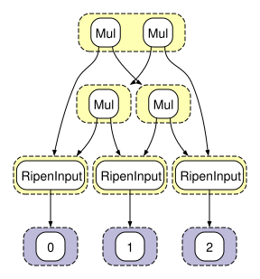
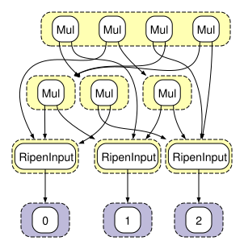
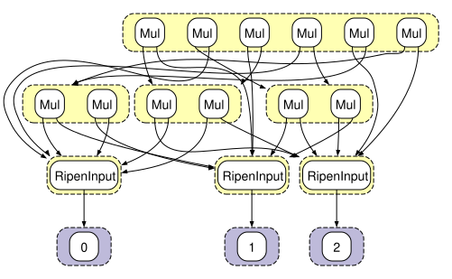
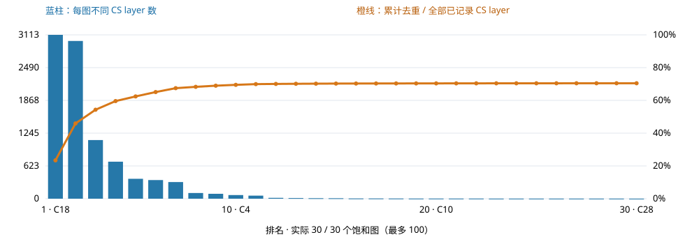

# math-microbenchmark：ripen / bake 决策报告

日期：2026-09-23。本次评估使用本地真实 egglog runtime，非独立模拟器。

**结论：已经证明存在额外的饱和归一化收益，但还不足以启动全面 bake 加速。可以做有限共享族的受控 bake 验证；目前不能声称能加速这个完整 workload。**

原始 11 轮程序的无 trace 和纯 trace 执行均完成。完整 CS/ripen 流水线两次在 180 秒外部观察窗口结束时仍未完成；本报告如实记录失败，不将第 9 轮检查点冒充完整 11 轮结果。

## 1. 实验口径

- 输入：`egglog/tests/math-microbenchmark.egg`，遵循文件中的 `(run 11)`，没有 rounds 覆盖。
- release、离线构建；使用同一份本地已修改 egglog 内核。无 trace 基线不是重新构建的 pristine upstream。
- 实现基线为 `f2fe288`；复测仅增加阶段计时。具体源码 SHA-256、机器信息及命令保存在 [measurements.json](results/measurements.json)。
- 180 秒是外部实验观察窗口，未写入 ripen 算法。窗口结束后终止进程组，Running 保持未完成；没有把超时当作 Saturated 或 infi。
- 无自动候选上限。所有观察到并登记的 CS 入口均进入当前处理流程，无法满足回放条件的入口明确 Rejected。
- 第一轮探索运行与诊断/编译有短暂重叠，只作复现失败现象的佐证；下列阶段成本使用第二轮复测。
- 基线测三次，trace 与阶段剖析各一次；不宣称统计显著性。时间区分引擎执行计时与整个进程时间。

## 2. 11 轮原生执行与 trace

| 路径 | 是否完成 11 轮 | 原生执行计时 | 峰值内存 |
|---|---:|---:|---:|
| 无 trace 第 1 次 | 是 | 0.3302 s | 485.7 MiB |
| 无 trace 第 2 次 | 是 | 0.2911 s | 491.7 MiB |
| 无 trace 第 3 次 | 是 | 0.3060 s | 491.0 MiB |
| dependency trace，每轮 drain，不建立 CS | 是 | 4.1282 s | 1.717 GiB |
| 完整 CS/ripen 复测 | 否 | 180.79 s 外部观察 | 6.721 GiB，采样下界 |

无 trace 中位数 0.3060 s；纯 trace 约为其 13.5 倍。trace 进程总时间为 4.50 s。基线/trace 内存取 macOS `/usr/bin/time -l` 的 maximum resident set size；完整流水线因外部终止没有可靠的 time 最终统计，使用每秒采样的进程组 RSS 最大值，不能视为精确峰值。

三次无 trace 的进程时间分别为 0.84 / 0.31 / 0.33 s。第一次数值包含启动开销，不能将它与引擎计时混用。

最终各 constructor 表行数在无 trace 与 trace 之间一致：

- Math enode 行数：**1,047,896**。
- Math e-class 数：**443,832**。
- 平均每个 Math e-class：**2.3610 个 enode**。
- 主要表：Add 641,743；Mul 345,075；Integral 32,434；Sub 15,123；Diff 13,504。

e-class 单独在未 trace 的同源执行完成后枚举 canonical 输出值测得；这次枚举不计入原生执行时间。

trace 的 11 轮累计记录 **944,211 个逻辑 match、6,036,059 个 trace event**。这些不是 committed mutation 数量。第 11 轮本身记录 823,091 个 match、耗时约 3.019 s，历史密度在末轮大幅增长。

## 3. 完整流水线在哪里停住

两次 180 秒运行均未完成。第一次最后完整队列检查点为 boundary 8；第二次为 boundary 9。第二次原生第 9 轮已执行且 CS/ripen 队列已写出，但整轮视图输出没有完整结束；`perf-round` 完整记录只有 1–8。第 10–11 轮没有完成证据。

第二次累计已完成的阶段计时（包括 boundary 9）：

| 阶段 | 累计时间 | 含义 |
|---|---:|---|
| register_entries | **147.286 s** | CS 发现、入口提取/验证、引擎准备、初始图输出 |
| advance_and_share | 12.693 s | 推进已登记 ripen、导出结果、等价实例复制 |
| exact_catalog | 5.438 s | 读取完成状态、建立精确判等共享目录 |
| weak_queries_and_evidence | 9.489 s | 查询索引、缓存 Join、binding 与报告证据整理 |

上述合计约 174.907 s；其余时间还包括采集、视图生成/写盘及中断时未完成工作。阶段名不能进一步被解释成纯算法 CPU 时间，例如 register_entries 也包含原生初始图渲染。

仅 boundary 9：register 97.272 s，推进 6.275 s，catalog 3.867 s，weak 7.220 s。登记阶段占已测阶段时间约 **84.2%**。探索运行的 3 秒栈采样也主要落在 `prepare_members` / entry extraction；该采样只说明当时热点，不代替全程统计。

**当前主要瓶颈不是精确判等，也不是 cached Join。** 首先需要解决入口提取、验证以及在重复入口上重复准备的成本，不能由 16 倍 Join 微基准推导整个 pipeline 的加速。

## 4. boundary 9 的完整队列分母

| 类型 | Saturated | Running | WaitingEquivalent | Rejected | 合计 |
|---|---:|---:|---:|---:|---:|
| 基础 CS 入口 | 9,374 | 101 | 396 | 3,433 | 13,304 |
| 复合入口 | 26 | 12 | 21 | 12,289 | 12,348 |
| 合计 | **9,400** | **113** | **417** | **15,722** | **25,652** |

登记的 composition 记录包括 11,603 个 CSCS、954 个 CCSS、1,294 个 CoarseJoin。记录数量不等于不同入口数量，因为相同成员接口可以复用同一 unit。

拒绝原因：

| 原因 | 数量 |
|---|---:|
| entry 回放/check 失败 | 8,975 |
| 外部行播种会提前物化 internal read，需要 staged injection | 4,315 |
| external row 依赖 internal result，需要 staged injection | 2,432 |

这些是支持/回放边界，不是“没有等价性”或“没有 bake 价值”。尤其不能只在剩余成功集上计算百分比，然后推广到全部组合。

26 个饱和复合入口包括 CCSS 17、CSCS 7、CoarseJoin 2。说明并非完全没有深层成功，但相对 12,348 个复合入口，成功完成比例仅约 **0.21%**；约 **99.52%** 被拒绝。有限观察也不能把尚未完成的 33 个复合任务判为失败。

## 5. 共享收益：剥离重复实例和入口文本差异

对全部 81 个已完成的物理 ripen 入口重新执行，并验证最终状态与原结果精确等价。之后分别对初始状态和最终状态进行同一套带规则环境/接口的精确判等，无新增采样或候选筛选。

| 表示层次 | 数量 |
|---|---:|
| 已饱和实例 | 9,400 |
| 不同入口文本 / 实际完成的物理任务 | 81 |
| **ripen 前不同初始结构** | **36** |
| **ripen 后不同饱和结构** | **30** |

因此：

- `9,400 → 30` 不能称为 tier0 内存压缩 313 倍；这主要衡量实例归组。
- `81 → 36` 说明入口文本差异和初始结构重复贡献很大，包括多余 check。
- **`36 → 30` 才是本次直接测出的 saturation 附加归一化收益：减少 6 个结构族，即 16.7%。** 6 个最终族各自合并了不同初始结构。
- 此结果只覆盖已完成、可导出的任务，有选择偏差；不覆盖未完成与被拒绝入口，也没有外部新输入的 holdout 验证。

### 一个非平凡的真实例子

- 入口 24：R3（乘法结合律），初始 7 行 fact。
- 入口 6566：R3、R1（乘法交换律）、R3，带实际相对 binding，初始 10 行 fact。
- 二者初始结构不等价，最终均成为同一接口下的 **15 行 fact**：12 个 Mul 行与 3 个 RipenInput 行。

不同初始状态经 saturation 汇合；这比重复序列化同一入口更接近需要的 bake 证据。以下文件保留真实绑定，不应把 rule name 序列单独当作组合的完整定义：

[入口 24 的 .egg](results/example-24/entry.egg) · [入口 6566 的 .egg](results/example-6566/entry.egg)







完整分组和每个入口的前后 fact 数见 [initial_ablation.json](results/initial_ablation.json)。fact 数包含接口 marker，不等于 tier0 可删除的 enode 数。

## 6. Top100 覆盖图



本次实际只有 30 个完成共享族。对 **13,304 个已记录基础 CS layer**，验证覆盖 **9,374 个，70.46%**；3,930 个未验证。不是全 11 轮分母，更不是 tier0 的 enode/e-class 覆盖率。

排名前三：C18 覆盖 3,113 个基础 layer；C15 覆盖 2,997；C16 覆盖 1,114。前三累计 7,224 / 13,304，约 54.30%。

覆盖沿用网页的精确入口成员归属算法，不把复合组合中包含某个 layer 就计作该 layer 已判等。有 10 个 trigger 不能归属基础 layer 分母，保留为 unattributed；不强行分摊。

[完整 CSV](results/coverage.csv) · [统计 JSON](results/summary.json)

## 7. 关于 infi 与耗散的证据

113 个 Running 物理任务只推进了 1–9 个 sweep，其中 63 个仅推进一次。180 秒是整条 pipeline 的观察时间，绝不是每个 cell 得到 180 秒 saturation。

检测到 5,795 条 weak 关系、451 条再入观察、0 条查询无法判定。**这些都没有证明 infi 或耗散性质**：新 effect 与新 binding 的同时出现不等于已证明特定递归的因果关系，更没有归纳证明可无限继续。

因此，本次全局超时主要揭示入口处理成本，不能据此把 Running 单元分类为 infi。离线 bake 不能直接把它们当作可复用的完整饱和图。

## 8. 是否现在开始 bake

**建议：只开始有限族的端到端 bake 实验，不进行全面接管 tier0 的实现。**

已经获得的证据：

1. 有大量已观察实例可归组。
2. 36 个初始结构经 ripen 合并为 30 个最终结构，存在真实的附加归一化。
3. 至少一些多规则入口与单规则入口共享同一结果。

仍缺的决定性证据：

1. 在不同于训练样例的输入上，库命中多少，边界 binding/alias 是否保持正确。
2. 注入饱和结果后是否与原运行得到相同目标结果，并正确处理 union、函数更新、subsume。
3. 触发查询、实例化、union/rebuild 的总成本，是否低于省掉的原始匹配成本。
4. 如何保留库外规则与跨边界交互；目前没有实现 live tier0 替换，所以没有实际加速数字。
5. 深层入口 staged injection 与回放失败尚未解决，不能用成功基础入口覆盖率替代深层泛化证据。

对这个单次原生执行约 0.306 s 的样例，当前分析 180 s 尚未完成；即便假设每次使用 bake 可以把原执行成本降到零，光摊平这段已付出的预处理时间也需约 590 次同等工作量的运行。这只是极乐观下界，不是对新样例的预测；真实回本次数会更高，也取决于库的复用分布。

优先次序：先利用初始结构判等避免重复准备/执行，修复复合入口回放边界，再用这里的已完成有限族做带未见输入的原生 A/B 对照。用那个实验决定是否扩大 bake，而不是继续扩大归组统计。

## 9. 复现

```sh
cargo build --release --offline --bin egg_layout --example native_math_baseline
EGG_LAYOUT_PROFILE=1 python3 experiments/math_ripen_report/run.py \
  --output out/math-report-reproduction --observe-seconds 180
python3 experiments/math_ripen_report/run.py --mode trace \
  --output out/math-trace-reproduction --observe-seconds 180
node experiments/math_ripen_report/summarize.mjs \
  out/math-report-reproduction out/math-report-summary
cargo run --release --offline --example ripen_initial_ablation -- \
  out/math-report-reproduction/analyze-11/saturated-rule-composition/queue.json \
  out/math-initial-ablation-reproduction
```

外部窗口可通过 `--observe-seconds` 调整；这不会改变程序 schedule、已登记入口或饱和判据。不同机器在截止时可能停在不同 boundary，必须使用同一 checkpoint 的分母重算，不能照抄本报告百分比。

本次完整原始目录保留在 `out/math-ripen-report-profile`、`out/math-ripen-report-trace` 和 `out/math-ripen-report-initial-ablation`；只提交可复现源代码、小型证据与报告，不提交多 GB 中间数据。

## 后续修复：CS 分阶段注入与 coarse fact 的等价条件

本节是后续版本的独立六轮对照，不覆盖上面的旧版九轮统计，也不声称完成 saturation。

修复：按 rule application 的依赖顺序准备外部 fact；引用本组合已产生的节点时，先检查该节点存在，再注入外部 fact。只检查该 fact 实际引用的变量。RipenInput 在首次外部使用时创建，避免提前占用内部输出。外部 constructor 读事件的输出身份随历史保存，保留它与已有 binding 的等价条件；这些是明确的 coarse fact，而不是由失败检查猜测的 union。

对同一源程序的前六轮，确认登记的 979 个组合的成员列表逐项一致：

| coarse facts 构造及逐步执行检查 | 修改前 | 修改后 |
|---|---:|---:|
| 单个 CS 对 | 316 / 407 | 405 / 407 |
| CS 对的组合 | 0 / 572 | 543 / 572 |
| 合计 | 316 / 979 | 948 / 979 |

剩余 31 项均明确定位到 recorded output alias 检查：例如历史要求 `Mul(a,b)` 与 `Mul(b,a)` 相等，但当前选中组合的逐步执行尚未证明它。没有通过补无来源 union 或忽略检查放行；这些项仍然拒绝。**948 是准备/验证通过数，不是饱和数，也不是 bake 命中数。**

新增回归覆盖分阶段引用内部节点、coarse fact 的显式等价条件，以及保存历史后离线重放得到相同的 symbolic CS 程序。旧历史缺少新的 read-results 字段时保持保守处理，不凭空恢复等价关系。

复现（只做六轮准备检查，不启动所有 ripen）：

```sh
cargo test --release --offline --lib math_six_round_preparation_audit -- --ignored --nocapture
```

完整逐项结果写入 `out/staged-cs-preparation/six-rounds.json`；精简前后统计见 [staged_preparation.json](results/staged_preparation.json)。
